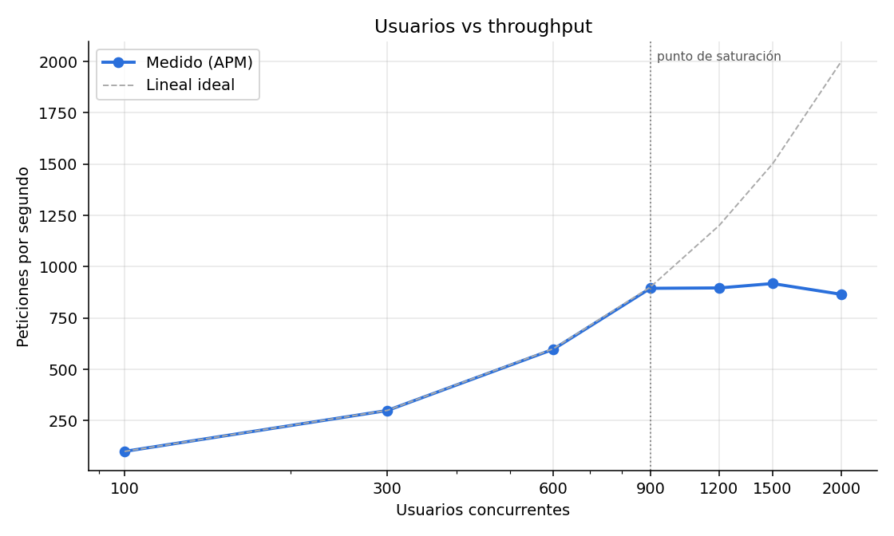
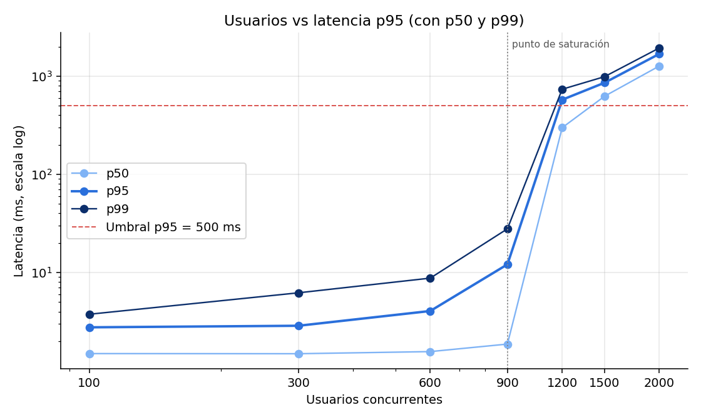
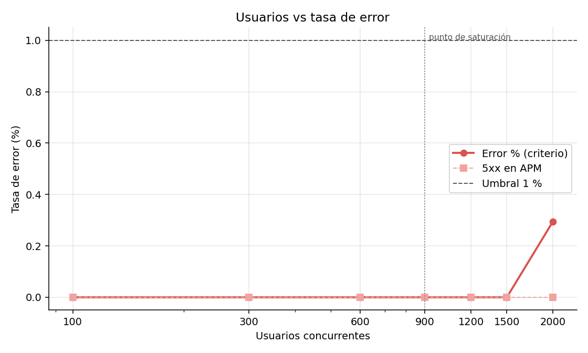
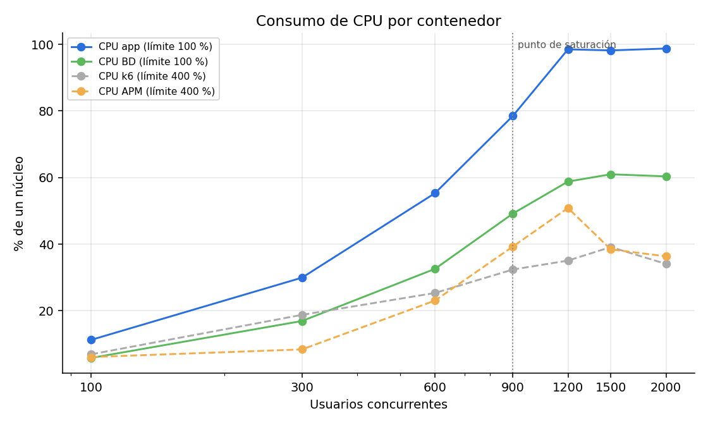
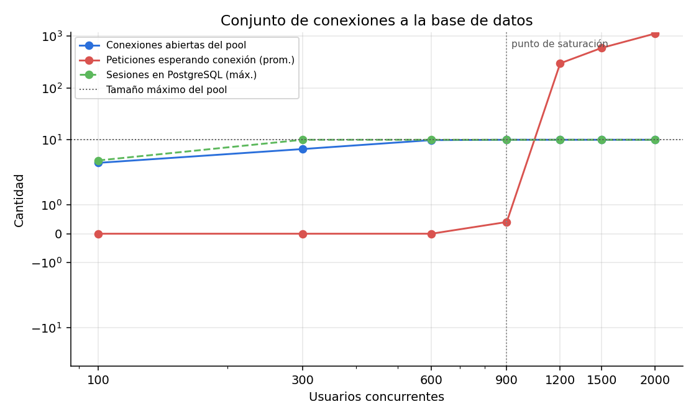
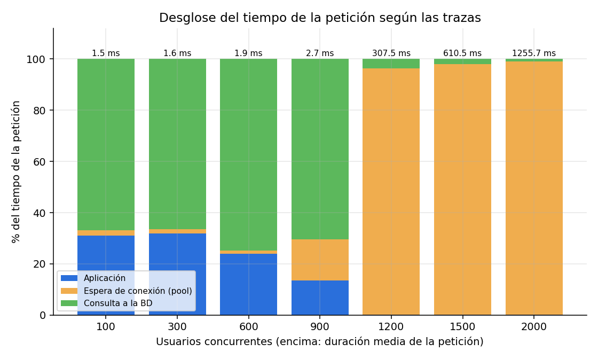

# Informe — Taller de Laboratorio N.º 4: Monitoreo con APM y prueba de estrés sobre el CRUD

**Asignatura:** Optativa IV – Sistemas de Tiempo Real Distribuidos · **Docente:** Juan Carlos Polania Cortes · **Periodo:** 2026-2
**Estudiantes:** Carlos Mario Ayala Ceballos y Santiago Gonzales Becerra · **Fecha de medición:** 19 de octubre de 2026

---

## 1. Respuesta a la pregunta central

> **La infraestructura sostiene 900 usuarios concurrentes con ≈ 895 peticiones por segundo**
> (p95 = 12 ms, error 0 %) usando **10 conexiones simultáneas a PostgreSQL**. Al pasar a
> 1200 usuarios el throughput se estanca en **≈ 900 pet./s** (techo medido entre 865 y 924
> pet./s en tres corridas) y la latencia p95 sube a 490–575 ms. **El recurso que impone el límite
> es el procesador del contenedor de la aplicación** (1 vCPU, Node.js): llega al 98–99 % mientras
> la base de datos se queda en 59–71 % de su núcleo, la memoria de la app en 76–115 MiB de
> 512 MiB y el generador de carga lejos de su límite.

La evidencia está en las secciones 5 a 7. Lo más importante: **triplicar el pool de conexiones
(de 10 a 30) no subió el throughput** (895 pet./s en ambos casos), así que el pool lleno es un
síntoma de la CPU saturada, no la causa.

## 2. Arquitectura y componentes (todo dockerizado)

| Componente | Tecnología | Contenedor | Límites |
|---|---|---|---|
| Aplicación CRUD | Node.js 20 + Express 4 + `pg` (pool = 10) | `app` | 1 CPU / 512 MiB |
| Base de datos | PostgreSQL 16, `max_connections = 100`, volumen `pgdata` | `db` | 1 CPU / 1 GiB |
| APM | Grafana + Tempo + Prometheus + colector OTel (`grafana/otel-lgtm`) | `apm` | 4 CPU / 4 GiB |
| Generador de carga | k6 0.54 | `k6` | 4 CPU / 2 GiB |

- **Instrumentación:** SDK de OpenTelemetry para Node.js con autoinstrumentación de `http`,
  `express` y `pg`. Cada petición genera una traza con el span HTTP, los spans de Express, el
  span `pg-pool.connect` (espera de una conexión libre) y el span `pg.query` (la consulta SQL).
  Las métricas `http.server.duration` (histograma con cubetas finas de 1 ms a 10 s) y
  `db.pool.{total,idle,waiting,max}` se exportan cada 5 s. Muestreo de trazas al 100 %.
- **Un solo comando:** `docker compose up -d --build` levanta app, BD y APM (ver `README.md`).
- Panel de Grafana aprovisionado: *Laboratorio 4 → Lab 4 - CRUD productos (APM)* con pet./s por
  operación, latencia p50/p95/p99, tasa de error por operación, pool de conexiones y trazas.

## 3. Diseño de la prueba de estrés

- **Escenario** (`k6/escenario.js`): 50 % listar (página aleatoria), 20 % consultar (id aleatorio
  entre 10 000), 20 % crear y 10 % actualizar, con nombre, descripción, precio y stock
  aleatorios en cada petición → **70 % lecturas, 20 % creaciones, 10 % actualizaciones**.
- Cada usuario virtual espera entre 0,5 y 1,5 s entre peticiones (≈ 1 pet./s por usuario).
- **Escalones:** 1 min de calentamiento (10 usuarios, descartado) + 7 escalones de 3 min:
  100, 300, 600, 900, 1200, 1500 y 2000 usuarios. De cada escalón se excluyen los primeros 15 s
  y los últimos 5 s.
- **Criterios de saturación** declarados antes de medir (`docs/CRITERIOS_SATURACION.md`): error
  ≤ 1 %, p95 ≤ 500 ms, throughput ≥ 90 % del esperado por el aumento de usuarios.
- La progresión sugerida (10…400) se ajustó tras una corrida de sondeo que no forma parte de los
  resultados: con 800 usuarios la app usaba solo ~68 % de CPU. Los umbrales no se cambiaron.
- Ficha del equipo y límites: `docs/FICHA_EQUIPO.md`.

## 4. Línea base en reposo (app + BD + APM encendidos, sin carga)

| CPU app | CPU BD | CPU APM | Memoria app | Memoria BD | Sesiones en PostgreSQL |
|---|---|---|---|---|---|
| 0,1 % | 0,4 % | 1,7 % | 35 MiB | 48 MiB | 0 |

## 5. Tabla de resultados (corrida oficial `resultados/corrida1`)

Latencias y error tomados del APM (Prometheus); CPU y memoria de `docker stats` (100 % = 1 núcleo,
que es el límite de app y BD); conexiones de `pg_stat_activity` y de la métrica del pool.

| Esc. | Usuarios | Pet./s | p50 (ms) | p95 (ms) | p99 (ms) | Error % | CPU app | CPU BD | Memoria app | Conex. BD (sesiones PG / pool abiertas de 10 / en espera prom.) |
|---|---|---|---|---|---|---|---|---|---|---|
| 1 | 100 | 100,1 | 1,5 | 2,8 | 3,8 | 0,00 | 11 % | 6 % | 48 MiB | 4 / 3,6 / 0 |
| 2 | 300 | 299,5 | 1,5 | 2,9 | 6,2 | 0,00 | 30 % | 17 % | 52 MiB | 7 / 6,6 / 0 |
| 3 | 600 | 597,7 | 1,6 | 4,1 | 8,8 | 0,00 | 55 % | 33 % | 58 MiB | 10 / 9,8 / 0 |
| **4** | **900** | **894,6** | **1,9** | **12,1** | **27,9** | **0,00** | **78 %** | **49 %** | **63 MiB** | **10 / 10 / 0,4 (máx 12)** |
| 5 | 1200 | 896,5 | 298,6 | 575,0 | 735,7 | 0,00 | 98 % | 59 % | 76 MiB | 10 / 10 / 297 (máx 440) |
| 6 | 1500 | 917,8 | 625,0 | 857,6 | 988,9 | 0,00 | 98 % | 61 % | 92 MiB | 10 / 10 / 589 (máx 755) |
| 7 | 2000 | 865,2 | 1269,1 | 1686,2 | 1937,2 | 0,30 | 99 % | 60 % | 115 MiB | 10 / 10 / 1114 (máx 1276) |

### Evaluación de los criterios

| Esc. | Usuarios | Error ≤ 1 % | p95 ≤ 500 ms | Throughput ≥ 90 % del esperado | ¿Cumple? |
|---|---|---|---|---|---|
| 1 | 100 | ✔ 0,00 % | ✔ 3 ms | ✔ — | Sí |
| 2 | 300 | ✔ 0,00 % | ✔ 3 ms | ✔ 100 % | Sí |
| 3 | 600 | ✔ 0,00 % | ✔ 4 ms | ✔ 100 % | Sí |
| **4** | **900** | ✔ 0,00 % | ✔ 12 ms | ✔ 100 % | **Sí — punto de saturación** |
| 5 | 1200 | ✔ 0,00 % | ✘ 575 ms | ✘ 75 % | No |
| 6 | 1500 | ✔ 0,00 % | ✘ 858 ms | ✘ 82 % | No |
| 7 | 2000 | ✔ 0,30 % | ✘ 1686 ms | ✘ 71 % | No |

### El generador de carga no fue el cuello de botella

La CPU de k6 promedió 7–39 % (máximo puntual 118 %) de un límite de 400 %, y el APM 6–51 % de
400 %. Las métricas del lado del cliente (k6) coinciden con las del APM: en el escalón 4 k6
registró 161 084 peticiones (≈ 895 pet./s) con p95 = 25,7 ms incluyendo red.

## 6. Gráficas

| | |
|---|---|
|  |  |
|  |  |
|  |  |

Las tres gráficas exigidas en el punto 9 son las tres primeras.

## 7. Confirmación y experimento sobre el escalón de saturación

Se repitió el tramo 900 → 1200 usuarios (3 min cada uno) dos veces más: una sin cambios y otra
con el pool de la aplicación ampliado de 10 a 30 conexiones (`DB_POOL_MAX=30`).

| Corrida | Usuarios | Pet./s | p95 (ms) | Error % | CPU app | CPU BD | Pool (abiertas / en espera prom.) | ¿Cumple? |
|---|---|---|---|---|---|---|---|---|
| Oficial, pool 10 | 900 | 894,6 | 12,1 | 0,00 | 78 % | 49 % | 10 / 0,4 | Sí |
| Oficial, pool 10 | 1200 | 896,5 | 575,0 | 0,00 | 98 % | 59 % | 10 / 297 | No |
| Repetición, pool 10 | 900 | 892,3 | 26,7 | 0,00 | 80 % | 65 % | 10 / 5,9 | Sí |
| Repetición, pool 10 | 1200 | 923,9 | 489,7 | 0,00 | 98 % | 70 % | 10 / 240 | No (throughput 78 %) |
| Experimento, pool 30 | 900 | 893,0 | 14,0 | 0,00 | 83 % | 61 % | 30 / 0,0 | Sí |
| Experimento, pool 30 | 1200 | 895,2 | 497,2 | 0,01 | 99 % | 71 % | 30 / 270 | No (throughput 75 %) |

- **El resultado se sostiene:** las tres corridas dan un techo de 890–925 pet./s y en las tres
  900 usuarios cumple y 1200 no. En la repetición el p95 de 1200 usuarios quedó apenas por debajo
  del umbral (490 ms), pero el criterio de throughput falla igual (78 %).
- **El pool no es el límite:** con 30 conexiones el throughput es el mismo (895 pet./s), la CPU de
  la app sigue en 99 % y siguen esperando ~270 peticiones aunque haya 30 conexiones. Tener más
  conexiones no ayuda si el proceso que las usa no tiene CPU para atender las respuestas.

## 8. Respuestas a las preguntas de análisis

**1. ¿Qué se degradó primero al cruzar el punto de saturación: la latencia o la tasa de error?
¿Qué indica ese orden?**

La **latencia**. Entre 900 y 1200 usuarios el p95 pasó de 12 ms a 575 ms (×47) y el p50 de 1,9 a
299 ms, con error en 0,00 %. El error solo apareció en el último escalón (2000 usuarios, 0,30 %:
462 peticiones fallidas en k6 y **ninguna 5xx** en el APM, es decir, peticiones que el cliente dio
por perdidas sin que el servidor llegara a responder con error). Ese orden indica que el sistema
**no rechaza trabajo, lo encola**: las peticiones que exceden la capacidad esperan en la cola del
event loop de Node.js y del pool de conexiones (hasta 1276 esperando). No hay control de admisión,
así que la saturación se ve como más tiempo de espera; los errores llegarían cuando la espera
supere los timeouts (5 s del pool, 10 s del cliente).

**2. Según las trazas del APM, ¿qué proporción del tiempo se consume dentro de la aplicación y qué
proporción en la base de datos? ¿Cambió esa proporción al aumentar la carga?**

Muestra de 150 trazas por escalón:

| Usuarios | Duración media | Aplicación | Espera de conexión (pool) | Consulta a la BD |
|---|---|---|---|---|
| 100 | 1,5 ms | 31 % | 2 % | 67 % |
| 300 | 1,6 ms | 32 % | 2 % | 66 % |
| 600 | 1,9 ms | 24 % | 1 % | 75 % |
| 900 | 2,7 ms | 13 % | 16 % | 70 % |
| 1200 | 307,5 ms | 0 % (0,8 ms) | 96 % | 4 % (11,5 ms) |
| 1500 | 610,5 ms | 0 % (0,7 ms) | 98 % | 2 % |
| 2000 | 1255,7 ms | 0 % (0,9 ms) | 99 % | 1 % |

Sin saturación, unos **dos tercios del tiempo se van en la consulta a la BD y un tercio en la
aplicación**. **La proporción cambió por completo** al saturar: desde 1200 usuarios el 96–99 % del
tiempo es espera de una conexión del pool, mientras el trabajo real (app ≈ 0,8 ms y consulta
≈ 11 ms) casi no crece. La petición no tarda más porque la consulta sea más lenta, sino porque
espera turno. Con la CPU de la app al 99 %, las conexiones se liberan tarde porque el event loop
tarda en procesar las respuestas de PostgreSQL. Por eso el experimento del pool de 30 no mejoró
nada.

**3. ¿El throughput siguió creciendo con cada escalón o se aplanó? Si se aplanó, ¿en qué valor?**

Creció de forma lineal (≈ 1 pet./s por usuario, 100 % de eficiencia) hasta 900 usuarios y **se
aplanó en ≈ 900 pet./s**: 894,6 → 896,5 → 917,8 → 865,2 pet./s con 900, 1200, 1500 y 2000
usuarios. Con 2000 usuarios incluso bajó un poco. Las corridas de confirmación dieron 923,9 y
895,2 pet./s con 1200 usuarios, así que el techo está entre **865 y 925 pet./s**.

**4. ¿Qué se agotó primero: el procesador, la memoria o el conjunto de conexiones a la base de
datos?**

**El procesador de la aplicación.** El pool de 10 conexiones se ve lleno antes (9,8 de 10 desde
600 usuarios), pero eso no limitó: con 600 y 900 usuarios el throughput siguió lineal y casi no
había peticiones esperando (0–0,4 de promedio). Además, con un pool de 30 el techo fue el mismo.
En cambio, la CPU de la app subió en proporción a la carga (11 → 30 → 55 → 78 %) y se clavó en
**98–99 % de su límite de 1 vCPU** justo cuando el throughput se aplanó. La memoria nunca fue
problema (máximo 115 MiB de 512 MiB, 22 %), la CPU de PostgreSQL se quedó en 59–71 % y su
`max_connections` (100) estuvo lejos (máximo 31 sesiones). Costo medido: ≈ 1,1 ms de CPU de la
app por petición (98 % de un núcleo / ≈ 900 pet./s), que incluye el costo de la instrumentación
con muestreo al 100 %.

**5. Proponga un cambio concreto para elevar el límite y explique por qué funcionaría.**

**Escalar horizontalmente la aplicación: 2 réplicas de 1 vCPU (o el módulo `cluster` de Node.js
con 2 procesos y 2 vCPU) detrás de un balanceador, con 10 conexiones de pool por réplica.**

- El recurso que satura es la CPU de un único proceso Node.js, que además solo usa un núcleo.
  Repartir la carga en dos procesos duplica la CPU disponible para la app.
- El siguiente cuello de botella sería la BD. Con ≈ 895 pet./s PostgreSQL usó 49–71 % de su
  núcleo según la corrida (≈ 0,55–0,8 ms de CPU por petición), lo que da un techo de
  ≈ 1250–1800 pet./s antes de que se sature. Por eso se espera pasar de ~900 a
  **~1250–1500 pet./s**, no a 1800 (el doble).
- Las conexiones alcanzan: 2 × 10 = 20 conexiones, muy por debajo de `max_connections = 100`.
- **No** se propone agrandar el pool: el experimento de la sección 7 demostró que no sirve.
- Como complemento barato: bajar el muestreo de trazas del 100 % al 10 %
  (`OTEL_TRACES_SAMPLER=parentbased_traceidratio`, `OTEL_TRACES_SAMPLER_ARG=0.1`) reduce el CPU
  que la propia instrumentación consume en cada petición, sin perder las métricas (que no dependen
  del muestreo).

## 9. Capturas del APM

> Tomarlas en <http://localhost:3001> con el rango de la corrida oficial:
> <http://localhost:3001/d/lab04-crud?from=1792441330380&to=1792442680380>

1. Panel de servicio completo (throughput, p95, error, pool) → `docs/capturas/01_panel_servicio.png`
2. Panel “Latencia por percentiles (p50/p95/p99)” → `docs/capturas/02_latencia_percentiles.png`
3. Panel “Tasa de error (5xx) por operación” → `docs/capturas/03_tasa_error.png`
4. Una traza individual desglosada (*Explore → Tempo*, abrir una traza de `GET /api/productos`,
   donde se ven `pg-pool.connect` y `pg.query`), una antes y otra después de la saturación
   → `docs/capturas/04_traza_individual.png`

## 10. Entregables

| Entregable | Ubicación |
|---|---|
| Código de la app instrumentada | `app/src/server.js`, `app/src/tracing.js` |
| Escenario de carga | `k6/escenario.js` |
| Imágenes y composición | `app/Dockerfile`, `analisis/Dockerfile`, `docker-compose.yml` |
| Instructivo | `README.md` |
| Declaración de criterios con fecha | `docs/CRITERIOS_SATURACION.md` |
| Tabla de resultados | Sección 5; `resultados/corrida1/tabla.md` y `resultados.json` |
| Gráficas | `resultados/corrida1/graficas/` |
| Capturas del APM | `docs/capturas/` (ver sección 9) |
| Ficha del equipo | `docs/FICHA_EQUIPO.md` |
| Respuestas de análisis | Sección 8 |
| Declaración de uso de IA | `docs/DECLARACION_USO_IA.md` |
